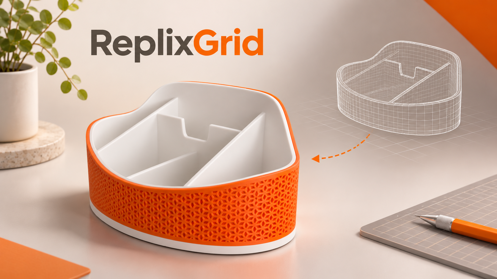

# ReplixGrid



ReplixGrid is a project from ReplixCast, the brand behind ReplixGrid. It is a local-first browser tool for designing customizable 3D-printable organizers. Set the dimensions, arrange compartments, adjust walls and add supported accessories or decorative shells, then export the parts for a slicer. Use the separate **Drawer** workspace to measure your drawer first, then create or add organizers and check their arrangement. No CAD application, account or application backend is required.

The interface is available in 11 languages. Printer presets set the build volume only; select the actual printer and material profiles in your slicer. ReplixGrid is an independent project and is not an official Snapmaker product.

## Two ways to use ReplixGrid

### Option 1: open the online app

**[Launch ReplixGrid at grid.replixcast.com](https://grid.replixcast.com/?lang=en)** — use the app directly in your browser, with no installation, account, or CAD software required. This link opens the interface in English; you can select another language in the app.

[Watch the Quick Start video (1:03, English)](https://grid.replixcast.com/guides/quick-start-en.mp4) · [Quick Start — build your first organizer](docs/USER-GUIDE.md) · [User Guide — full feature reference](docs/REFERENCE.md)

[Instructions in all 11 interface languages](docs/LANGUAGES.md). Help opens the matching language automatically.

### Option 2: run it locally on your computer

Prefer a local copy? Follow the Windows and macOS setup instructions below. Both options let you design organizers and export files for your slicer.

Projects are saved in the browser at the address you use. To move between the local and online versions, download your project JSON and open it in the other version. Configure filament slots again at the new address.

## Local installation

These instructions are for Windows and macOS, including people who have never used a terminal. You will download the project, install Node.js, and start the app on your own computer. **You need an internet connection for the first installation.** No GitHub account, Git installation, or programming experience is required.

> Local installation is optional. After setup, the local app opens in your browser while a terminal window is running. For the online version, simply open [grid.replixcast.com](https://grid.replixcast.com/?lang=en).

### 1. Download and extract ReplixGrid

1. Open the [ReplixGrid repository](https://github.com/gromvs75/ReplixGrid) in your browser.
2. Click the green **Code** button, then **Download ZIP**. Wait for the download to finish.
3. Open your Downloads folder. On Windows, right-click the ZIP file and select **Extract All**, then **Extract**. On macOS, double-click the ZIP file to extract it.
4. Open the extracted folder. It is usually named `ReplixGrid-main`. Make sure you can see `package.json` inside it. If you see another folder with the same name, open that folder too. Keep this folder somewhere you can find it later; do not work from inside the ZIP file.

### 2. Install Node.js

Node.js is the program needed to run ReplixGrid. Its installer also includes npm, which downloads the project's dependencies. Use Node.js 24 LTS or a newer supported LTS version.

1. Visit the official [Node.js download page](https://nodejs.org/en/download).
2. Choose a **Long Term Support (LTS)** version and the installer for your operating system: Windows Installer (`.msi`) for Windows, or macOS Installer (`.pkg`) for macOS. If asked, choose the architecture matching your computer.
3. Open the downloaded installer and follow its instructions. The default options are normally suitable. When installation is complete, close and reopen any terminal or Command Prompt windows.

### 3. Open a terminal in the project folder

**Windows:** Open the extracted folder containing `package.json` in File Explorer. Click the address bar at the top, type `cmd`, and press Enter. A Command Prompt window opens in that folder.

**macOS:** Open **Terminal** using Spotlight (press Command + Space, type `Terminal`, and press Return). Type `cd` followed by a space, drag the folder containing `package.json` from Finder into the Terminal window, and press Return. For example, your command may look like this, though your path can be different:

```sh
cd /Users/yourname/Downloads/ReplixGrid-main
```

In either case, check that Node.js and npm are available. Type each line separately and press Enter after each:

```sh
node --version
npm --version
```

Both commands should show a version number. If a command is not recognized, close and reopen the terminal and try again. If it still fails, reinstall Node.js using its official installer.

### 4. Install and start the app

In the same terminal, make sure you are in the folder containing `package.json`. Type the following command and press Enter:

```sh
npm ci
```

Wait until it finishes and the command prompt appears again. This downloads the required packages and can take a few minutes. If you see an error, check your internet connection and verify that the terminal is in the correct folder.

Now type the next command and press Enter:

```sh
npm run dev
```

Wait until the terminal displays `http://127.0.0.1:5173/`. The local server uses port **5173** and stops with an error if it is occupied; it does not switch to a different port. Open that address in a browser on the **same computer**. You can now use ReplixGrid. Keep the terminal window open while using the app; closing it stops the local server. The `127.0.0.1` address refers to your own computer.

### 5. Stop and reopen later

To stop ReplixGrid, return to the terminal and press **Ctrl + C** (on both Windows and macOS). If Windows asks whether to terminate the batch job, type `Y` and press Enter.

To start it again later, open a terminal in the same project folder as described in step 3, run `npm run dev`, and open the local address in your browser. You normally do **not** need to run `npm ci` again unless you download a new version or the project's dependencies change. Keep the same browser and address to access your local projects, and download project files for backup.

If you see `EADDRINUSE` or a message that port `5173` is in use, an earlier instance or another program may already be using it. If ReplixGrid is already running, try opening the address above. Otherwise stop the earlier instance, or free that port and try `npm run dev` again.

See the [user guide](docs/REFERENCE.md) for editing, saving, exporting and printing.


## Before printing

- Download project JSON files for backup. Browser storage is local to the browser and site address; clearing it can remove projects. Filament slots are stored separately and must be configured again on another device.
- Split printing currently requires removing shells and inserts. Sections use pins and glue; wall and floor thicknesses increase to at least 5 mm and 3 mm respectively.
- Check placement of all parts, overhangs, fine features, filament assignments and print settings in the slicer. Export checks do not replace slicing or a fit test.

## License

ReplixGrid is available under the [MIT License](LICENSE). Third-party components have their own licenses; the Droid font outline notice is retained in [src/fonts/NOTICE](src/fonts/NOTICE).
