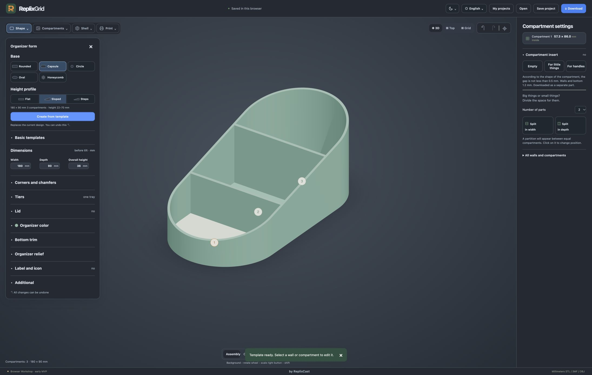
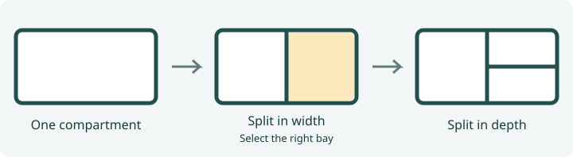
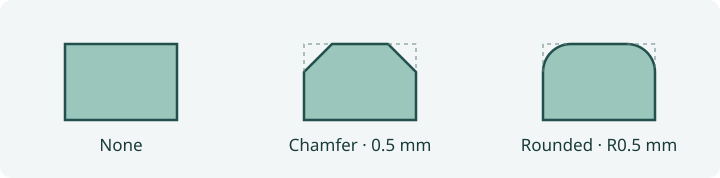
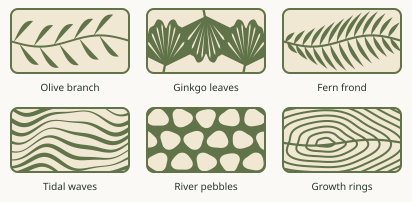
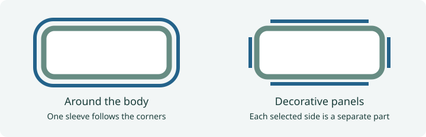

# ReplixGrid User Guide

Design an organizer in millimeters, check its fit, and download the parts for your slicer. For a first build, follow the illustrated capsule example. Use this reference when you want to change a particular part of your design.

[Open ReplixGrid](https://grid.replixcast.com/?lang=en) · [Quick Start](USER-GUIDE.md) · [Local installation](../README.md#local-installation)

| I want to… | Go to |
| --- | --- |
| Select a wall, rotate the model or undo a change | [Workspace and views](#workspace-and-views) |
| Choose a shape, change dimensions or lean the walls forward | [Shape and dimensions](#shape-and-dimensions) |
| Fit an object into a compartment or move a divider | [Compartments and dividers](#compartments-and-dividers) |
| Lower a wall, shape its edge or cut a finger opening | [Wall heights and cutouts](#wall-heights-and-cutouts) |
| Soften a rim, add texture or put a name on the body | [Corners, edges and decoration](#corners-edges-and-decoration) |
| Add a removable cup, stack trays or fit a lid | [Inserts, tiers and lids](#inserts-tiers-and-lids) |
| Print a decorative cover for the outside | [Sleeves and panels](#sleeves-and-panels) |
| Reopen a design or move it to another computer | [Projects and backups](#projects-and-backups) |
| Choose a printer, split a large model or assign filament | [Print setup and sectioning](#print-setup-and-sectioning) · [Download and slice](#download-and-slice) |
| Keep alternative designs or reuse colors and patterns | [Project variants](#project-variants) · [Shared styles](#shared-styles) |
| Arrange organizers in a measured drawer or fix them to a plate | [Drawer arrangements](#drawer-arrangements) · [Mounting plates](#mounting-plates) |
| Import artwork for walls, lids or a perforated shell | [Custom SVG](#custom-svg-relief) · [Pattern Studio](#pattern-studio) |
| Download all drawer parts arranged for the printer | [Whole-drawer export](#whole-drawer-export) |
| Work out why a control or download is unavailable | [Troubleshooting](#troubleshooting) |

## Start a new project

On your first visit, the workshop opens without a model. Choose **Rounded**, **Capsule**, **Circle**, **Oval** or **Honeycomb** to create a simple body. A non-modal panel beside the left menu guides you through three steps: **Choose a shape**, **Set dimensions**, and **Add compartments**. Choosing a shape opens dimensions inside this panel; **Next: compartments** opens the final step. The canvas stays visible and interactive. Use **Done** or **Keep without dividers** to finish, or close the helper with **×** after choosing a shape. Honeycomb starts with its connected cells; the other bases start without dividers.

Reopen the helper at any time with **Help → Helper: three steps**. Opening it keeps the current model; choosing another shape replaces the model and can be undone.

All Help menu labels follow the selected interface language. Quick Start and User Guide open in that language. The video is in English.

The helper follows the interface language, including all three steps, hints and the saved-project confirmation. The saved-project row uses the translated label **Previous project**. Actual project names in **My projects** remain as you saved them.

Use **New project** in the top bar to return to this clean start. Your current work is saved first; an unnamed draft is retained in **My projects**. Existing projects, variants, filament slots and printer configuration are not deleted. The panel shows a thumbnail labelled **Previous project** with **Saved in My projects**; click that row to reopen your library. The canvas is cleared immediately and stays empty until you choose a new shape, just as on a first visit. Until you choose a new shape, saving and exporting are disabled. You can instead open a project from **My projects** or import its JSON file. Refreshing this empty-start tab keeps the start screen; reopening an existing project restores the model. Ordinary return visits resume saved work.

Choosing **Shape → Base → Create from template** while editing still replaces the construction inside the current project and can be undone. Use **New project** when you want a separate model.

## Workspace and views

Open a tool in the upper left. **Shape** changes the body and its accessories. **Compartments** changes the layout. **Shell** designs a separate outer cover. **Print** sets the build volume, filament slots and optional section cuts. Click a compartment number, wall or divider on the model to open its settings on the right. If a part is hard to click, expand **All walls and compartments** and select it by name.

The left panel is section navigation. Select a section to open only its settings in the centered, floating editor at the bottom of the preview. The scene and grid continue behind the editor; opening it does not cut off the preview. The editor uses compact groups; it does not replace the left menu. Its chevron collapses the editor and **×** closes it. Choose another section on the left to switch settings. The right panel remains dedicated to the selected wall or compartment.

Drag the background to rotate, scroll to zoom, and drag with the right mouse button to pan. **Return camera** restores the camera framing. **Top** helps you select a narrow compartment or move a divider. **3D** shows wall heights and the finished assembly. **Grid** toggles the reference grid, with fine lines every 10 mm and major lines every 50 mm. Use the part buttons centered above the model to isolate the organizer, inserts, shell or lid when present. **Assembly** shows the available parts together for the current view. For multiple tiers, choose **View stack** in the dropdown beside **Organizer** to show the entire stack; choose **Tier 1**, **Tier 2**, or another tier to return to that tier. The bottom settings editor stays open. In stack view, **Shell** and **Inserts** include parts from all tiers. On narrower windows these buttons move to their own row below the toolbars. With the lid isolated, choose **Bottom** to inspect its underside. Press **Esc** to close the tool panel. Use the curved arrows above the model to undo or redo a design change.

Use the top bar to choose an interface language or switch between light, dark and system appearance. Control names in this guide follow the selected interface language.

## Shape and dimensions

Under **Shape → Base**, choose a base and height profile, then click **Create from template**. The button replaces the current construction. Save a named copy first if you want to keep both designs. **Basic templates** also offers an empty body and a four-compartment starting point.

| Base | When to choose it |
| --- | --- |
| Rounded | A rectangular footprint with adjustable outside corners. |
| Capsule | A long body with semicircular ends. The sloped template carries the incline through both curved ends. |
| Circle | A round organizer sized by diameter. |
| Oval | An elongated curved outline with separately adjustable width and depth. |
| Honeycomb | A cluster of hexagonal cells that share walls. Select a cell to adjust its height. |

Choose **Flat** for a level rim, **Sloped** for a continuous rise, or **Steps** for distinct height levels. The dimensions below the choices describe the template you are about to create. Once created, edit the model under **Dimensions**. Width and depth measure the outside footprint. Use the selected compartment's inside dimensions when sizing it for an object. On a curved base, also check the narrowing ends in **Top** view.

**Shape → Additional** contains wall and bottom thickness. Thicker walls take space from the compartments. **Tilt on a flat base** leans the walls forward by up to 25° while the bottom stays horizontal. This differs from a sloped rim, which changes wall height along the body. With tilt enabled, use the finished dimensions in the download dialog to check the space the printed part will occupy.

## Exact internal dimensions

Select a compartment and use **Internal dimensions** in the right panel, or click its blue dimension label directly on the model. Choose width or depth, enter millimeters and click outside the inline field to apply. Enter also applies; Escape cancels. The right panel retains its Apply button. Invalid values cannot change the model. Each committed edit can be undone in one step.

The orange divider is its current position; the dashed blue line previews the new position. The closest enclosing split on the chosen axis moves, keeping the outside body size and wall thickness unchanged. The panel shows affected neighboring sizes. If there is no divider on that axis, adjust the overall dimensions or split the compartment first.

In a simple row, start with compartment 1 and continue in order; the last compartment takes the remainder. Neighboring dimensions are not locked, so editing an earlier compartment can resize a later one.

Rounded corners, capsule contours, chamfers and inner fillets remain supported. The blue line measures the actual internal span at the compartment centreline, just above the floor. Space can narrow elsewhere around curves: add clearance and check the whole object footprint. Circle, oval, honeycomb and tilted walls do not currently support exact compartment editing.

Select a wall or divider to edit its height directly on the model. Flat walls show one value; two-point profiles show A/B values. Linked-height and stepped-wall rules match the right panel. These labels edit height, not wall length or global thickness.

## Compartments and dividers

For a quick layout, use **Compartments → + Compartment** to split the largest compartment. **− Compartment** merges a neighboring pair. In a honeycomb, these controls add or remove an outside cell and preserve the size of the others. Two neighboring honeycomb cells share a wall as high as the taller cell.

For an exact layout, switch to **Top** and select the compartment you want to divide. Choose **Number of parts**, then **Split in width** to divide the width into narrower compartments, or **Split in depth** to make shallower ones. You can split one of the results again. For a pencil bay beside two small trays, first split the width in two, then split only the tray side in depth.

Select the divider to drag it, or adjust **First compartment** under **Partition position**. Only the selected divider moves; other divider positions remain fixed. The adjacent compartments change size. Moves that leave too little space are rejected. Check the new inside dimensions on each side. **Remove partition** combines the compartments and can also remove dividers nested inside that split. Review the highlighted selection and the confirmation before removing it.

## Wall heights and cutouts

Select an outside wall or divider. **One height** sets a level top. **Two points** lets you set the heights at ends **A** and **B**, which are marked on the model. Choose **Straight**, **Wavy** or **Zigzag** to shape the edge along the wall. Wavelength controls the distance between repeats. In a stepped template, selecting a step adjusts its level together with the linked wall and divider.

Use **Connect the heights of adjacent walls** to make an outside wall follow its neighbors. For a divider, **Fit to adjacent walls** copies the two end heights once. Repeat the fit after changing the neighboring walls. **Like the others** returns the selected wall to the common height.

Open **Wall cutout** to make a reach-in opening. Choose a smooth scoop, semicircle or rectangular opening, set the width and depth, then move it along the wall. Position runs from end A to B. Depth is measured down from the top edge. Inspect the remaining lip above the floor. Choose **No cutout** to fill the opening. Honeycomb uses cell height instead. Stepped circles and ovals do not support cutouts in the outside walls.

## Corners, edges and decoration

Open **Shape → Corners and chamfers**. Three controls affect different parts of the print.

| Control | Where to look | What it changes |
| --- | --- | --- |
| External corners | Top view, outside outline | Round the footprint corners or cut them at 45°. Zero gives a square corner. Available on the rectangular family of bases. |
| Radius inside compartments | Top view, inside a bay | Rounds the vertical junction where two walls meet. Tight bays limit the available radius. |
| Top edge of walls and dividers | Cross-section through a wall | **Chamfer** cuts a flat bevel and **Rounded** curves the lip. Both sides of outside walls and dividers receive the finish. **None** restores the square lip. |

For example, on a 2 mm wall try a 0.5 mm chamfer. Each side loses 0.5 mm at the very top, leaving a 1 mm flat strip. The maximum displayed size depends on wall thickness. With **Rounded**, the value is the radius in millimeters.

- **Organizer color** changes the preview and color-capable exports. Choose a swatch, a custom color or a configured filament color. Assign the actual filament slot at export.
- **Bottom trim** adds a projecting band around the base. Choose smooth, striped or stepped trim and set its height. A compatible sleeve can rest on it. Trim requires an untilted, single-piece body and is available on the first tier. Separate panels sit above it with the selected edge offset.
- **Organizer relief** adds a raised pattern directly to the outside wall. Scroll the pattern catalogue, set pattern size and relief height, and watch the model update during dragging as each calculation finishes. The final value uses full precision. The inside stays smooth. The projections increase the outside dimensions. Choose **Smooth** to remove the relief.
- **Label and icon** puts lettering or a symbol on a selected side. Enter the text, choose a font, set letter height and vertical position, then choose raised lettering or engraving and set its height or depth. A star or heart can accompany the text. On circular and oval organizers, text and icons follow the curved wall, including in STL and 3MF exports. Letter spacing is measured along the surface. Choose Front, Rear, Left or Right to center the inscription on that side. On circles and ovals with linked or varying wall heights, lettering stays below the lowest wall profile and cutout. Honeycomb lettering is not yet supported; shells covering the chosen side and relief can also prevent lettering. Flat-wall lettering still requires a constant-height profile. If the inscription runs into a cutout or exceeds the available face, lower the position or reduce the letter size.

## Inserts, tiers and lids

**Removable inserts.** Select a compartment, then expand **Compartment insert** on the right. **Empty** makes an open cup. **For little things** adds a grid with adjustable rows and columns. **For handles** creates sockets for pens or tools. Set the socket's inside diameter and the app fits as many as the insert allows. Choose a fitted, rounded, circular, oval or hexagonal outline and a color. **Remove insert** clears that bay. An empty cup is still a printable part.

The insert follows its compartment with at least 0.5 mm clearance. Its walls and bottom are 1.2 mm thick and its height adjusts to finish roughly 1 mm below the rim. An insert in a tilted organizer comes out along the slope. Isolate **Inserts** to inspect them, then export **Organizer and accessories**. Inserts require single-piece printing.

**Stacked trays.** Start with a level rim, then open **Shape → Tiers → + Tier**. You can use two to five tiers; **− Tier** removes a tier. Tiers share a footprint but can have different compartments, heights, colors and decoration.

1. In the dropdown beside **Organizer** above the model, choose **Tier 1**, **Tier 2**, or another tier. That tier is shown on its own, and the current settings editor stays open.
2. Edit the selected tier with the usual shape, compartment, relief and shell controls. Changing the tier does not copy its settings to other tiers.
3. Choose **View stack** in the same dropdown to inspect all tiers and accessories together. Use **Assembly**, **Organizer**, **Inserts**, **Shell** or **Lid** to show the parts you need. Return to a numbered tier to continue editing it.
4. Under **Shape → Tiers**, adjust **Fit clearance** and print a small fit sample before committing to the full stack. Lower dividers that stand above the rim. Stacking requires upright walls and a continuous supporting rim.

Built-in and SVG relief decorate each tier's exterior while mating collars, tongues and sockets stay smooth. Wrapped shells and decorative panels can cover individual tiers. For panels, keep **Edge offset** at least 3 mm so they clear the mating collars.

With a wrapped shell, a tongue inside the lower wall fits a socket below the upper tray's floor. Compartment widths, depths and usable heights remain unchanged; each socket adds 2.2 mm to the assembled stack's outside height. Matching shells meet at a narrow 0.8 mm support band. Shells slide on from above; separate the tiers before removing them. Each shell exports as a separate tier-numbered part.

**Bottom trim** is available on the first (lowest) tier only: choose smooth, rings or steps. With a compatible wrapped shell, the trim also supports the shell. Separate panels sit above the trim with the selected edge offset. New upper tiers do not inherit the trim. If the tongue cannot fit within the wall thickness, reduce **Fit clearance**; the application does not thicken the wall automatically. A wall cutout must leave enough material near both corners to support the tray above it.

**Lid.** In **Shape → Lid**, click **+ Cover**. Use a level upper rim with equal outside wall heights and dividers at or below it. Tilt, honeycomb and sectional printing prevent this fit. Choose **Overlapping** for an outside cap or **Inset** for a 2 mm plate that sits flush inside the tray. The inset option cuts a seat in the upper wall with 0.35 mm clearance on each side and leaves room above dividers and inserts. It needs at least 2 mm wall thickness and 4 mm inside depth. Add a wall cutout or a handle to lift it. The overlapping lid has a locating rim with 0.5 mm clearance. Choose its top pattern, scale and depth, then set the rim height and finish. For a handle, choose cylindrical or bar, set its size and height, and optionally chamfer or round its edges. The handle prints separately and glues to the lid. The preview lifts the overlapping lid and shows the inset lid seated. The exported lid lies flat for printing.

**Two-tone pattern.** Enable it on either lid fit, then choose Olive branch, Ginkgo leaves, Fern frond, Tidal waves, River pebbles Growth rings or Voronoi cells. Choose a base color and a pattern color. The 3.2 mm plate has a solid 1.6 mm backing and a 1.6 mm patterned face. The outer locating rim and optional handle add to the overall height. For an inset lid, allow at least 5.2 mm inside depth. Export in 3MF to keep both colors together as one lid, and assign the two parts to your filament slots. For Olive branch, Ginkgo leaves, Fern frond, Tidal waves and Growth rings, **Cutwork pattern** makes the motif out of openings in a continuous top sheet. Combine it with **Raised pattern** to expose the recessed backing through the openings. Enable **Raised pattern** to leave the openings in the upper 1.6 mm empty. Disable it for a smooth inlay. Raised inset lids print backing first; overlapping lids print patterned face down. Check bridging over the recesses in the slicer.

## Sleeves and panels

Open **Shell** and choose a pattern. A shell is printed separately from the organizer. If you want the pattern on the body itself, use **Shape → Organizer relief**.

| Shell mode | Fit and assembly |
| --- | --- |
| **Around the body** | One bottomless sleeve follows the perimeter and wall heights. Slide it over the body from above, following the wall direction on a tilted model. The panel indicates whether a support ledge is present or the sleeve rests on the table. |
| **Decorative panels** | Separate framed panels cover selected sides and leave the corners exposed. Choose the sides and adjust **Edge offset**. Glue panels without fastenings. With hidden pins, press each panel straight onto its matching wall for a permanent attachment. |

Choose the pattern, set its size and set **Shell thickness**. For a one-piece sleeve, adjust **Border width** for its solid frame. Decorative panels have a fixed frame; use **Edge offset** to position them on the wall. Under **Landing**, **Clearance on each side** sets the gap between sleeve and organizer. A 0.5 mm gap on each side adds 1 mm across two opposite sides before you count shell thickness. Compare **Assembly** with the isolated **Shell** view to judge the result. **Download shell** exports the cover separately, and **Remove shell** removes it from the design.

Panels require a compatible rectangular base. Switching to panels preserves wall thickness and compartment space. Hidden mounting sockets require walls at least 3.2 mm thick without relief. For thinner walls, including 2.4 mm, use panels without fasteners and glue them in place. Wall thickness is never raised automatically. Panel edge offset controls the margin on the face, whereas sleeve clearance controls the sliding fit. With bottom trim, the lower offset starts at the top of the trim; panel fasteners and sockets follow the same profile. Tiers require at least 3 mm edge offset to clear their mating collars.

## Projects and backups

Use **My projects → Save a copy** to name a design or make a variant before experimenting. The open project saves automatically in this browser. The library lets you search, open, rename, delete or download a project. **Save project** in the top bar downloads an editable JSON backup. Use **Open** to load that file, including on another computer or in a local installation.

Committed edits are saved immediately. A temporary local recovery copy protects changes while the browser database is saving; reopening restores that copy if a write was interrupted. A separate last-successful snapshot can recover a damaged current session, including undo history. If no valid copy can be restored, automatic saving stops instead of replacing the stored project with a starter model. Keep downloadable JSON backups: browser data clearing or failure of both storage mechanisms cannot be recovered automatically.

Export checks belong to the current project revision, selected parts and mounting position. Changing these invalidates the previous check; an old result cannot be downloaded as the new model. Failed calculations retain edits. A stalled preview reports an error after two minutes; the next geometry edit starts a new calculation.

When the same project or drawer is edited in multiple tabs, conflicting changes are saved as a separate **Copy from another tab**. The other version is kept, and the editing tab continues with its copy. Compare the versions in **My projects** or the drawer selector and rename the copy if you want to keep it. Reopening an organizer tab restores its own saved project. Changes are not automatically merged between tabs.

Keep a downloaded backup before clearing browser data. Each browser and site address has its own library. Filament slots are stored separately for the printer in the browser. Set them up again when moving to another device. For the downloadable local app, see [Local installation](../README.md#local-installation).

## Print setup and sectioning

Under **Print**, select your printer and head configuration or choose **Custom size**. Check build width, depth and height. The preset supplies the build volume. Choose the printer, nozzle, material and slicing profiles in your slicer.

For a model that exceeds the bed, use the suggested cuts or choose two or three sections when available. Read the proposed seam positions and use **Move the parts apart** to see how the sections meet. Splitting increases wall thickness to at least 5 mm and floor thickness to at least 3 mm. Recheck the inside dimensions. Remove shells and inserts before splitting. Stacked trays, tilted models and the circle, oval and honeycomb bases require single-piece printing. **Return solid model** switches off sectioning. Check thickness again if you want to restore earlier dimensions.

**Joint sample** downloads mating ends to try at the same scale and print settings as the final body. Place them separately with their bases down. After cooling, the nominal Ø 3.2 × 8 mm pins fit into Ø 3.3 mm holes, 4.5 mm deep on each side of the seam. Check alignment, then use pins and glue to assemble the printed sections. Use **Download all parts** for the sectioned organizer itself.

## Download and slice

1. In **Print**, configure filament slots if you want a multicolor file. Match slot numbers and colors to your slicer. On a Snapmaker U1, slots 1–4 correspond to T0–T3. Add up to 16 slots, set each color and optionally name its material. Color is an approximate visual guide, not a simulation of a printed or mixed shade. Configure exact colors and mixing in your slicer. Select any filament card and choose **Delete filament from slot N** to remove it. The remaining slot numbers do not change: deleting slot 6 leaves slot 7 as slot 7. **+ Slot N** adds the lowest available number again; the limit stays at 16. Deleting a filament does not change the model color. Removed slots are no longer offered or automatically matched at export; choose another slot explicitly or assign it in the slicer. Distinct colors let the app match part colors to slots automatically. If two slots share a color, choose the intended slot for each part in the download dialog.
2. Click **↓ Download**. Choose **Organizer and accessories**, **Shell only** or **The whole set**, according to which parts you need. For a sectioned model, export the kit.
3. Select a format below. For 3MF, assign a filament slot to each part or leave it for assignment in the slicer. Orca can use the first filament for unassigned parts.
4. Wait for the geometry and size checks. Read the dimensions of each part and any instruction to rotate it 90° on the bed. The check reserves 2 mm at the bed edges. Download with the format button at the bottom of the dialog.
5. Open the result in your slicer at **100% scale in millimeters**. Arrange the complete set, check overhangs and thin details, and preview the first layer and dividers. For a multicolor print, verify each part's filament assignment before slicing.

| Format | Choose it for | What to do with the download |
| --- | --- | --- |
| STL | Geometry for a single-color print | Open the STL in the slicer. Extract the ZIP first if the export contains several STLs. |
| 3MF | A kit with separate parts, colors and filament assignments | Open it in your slicer and verify the parts and slots. ReplixGrid leaves printer and material profiles to the slicer. |
| OBJ + MTL | A colored model for a tool that accepts OBJ | Keep the geometry and material file together. The model uses millimeters with Z up. |
| Project JSON | Continuing to edit compartments, dimensions or accessories | Use **Save project** and reopen it with **Open** in ReplixGrid. |

To match a digital color from your slicer, paste its six-digit **HEX code**, for example `#E63522`, beside the color picker. The leading `#` is optional. Valid codes update the preview immediately; incomplete or invalid text is not applied and reverts to the saved color when you leave the field. A matching HEX code does not simulate filament appearance, lighting or a physical color mixture.

## Troubleshooting

| What you see | What to check |
| --- | --- |
| The object fits the outside dimensions but will not fit in a bay | Select the compartment and check its inside measurements. Allow for wall thickness, curved ends, inside corner radius and removable inserts. |
| Selecting a divider keeps selecting the wall in front | Switch to **Top** or open **All walls and compartments** on the right. |
| The lid or next tier cannot be added | Check for a level rim, equal outside heights, protruding dividers, tilt or split printing. For a stack, also check legacy shell clips and fit clearance relative to wall thickness. Built-in and SVG relief are supported on individual tiers; the mating surfaces remain smooth. |
| A part exceeds the bed although the footprint seemed small enough | Read the finished dimensions in the download dialog. Tilt, relief, trim and shells can extend beyond the base. Check the selected printer configuration and rotation. |
| Hidden panel fasteners are unavailable | Use walls at least 3.2 mm thick without relief, or leave fasteners off and glue the panels. Changing to panels does not thicken the walls. |
| Panels overlap the bottom trim or tier rim in an old design | Set an edge offset of at least 3 mm for tiers. The lower offset is measured from the top of the bottom trim. Regenerate and download the parts after changing the settings. |
| A downloaded print has the wrong colors | Use 3MF, match the slot numbers in **Print**, then inspect the per-part assignments in the slicer. STL carries geometry only. |
| A design saved on another device is missing | Transfer its project JSON and use **Open**. Browser libraries are local to each device and site address. |

## Project variants

Click **+ Variant** in the top bar, or open **My projects** and select **New variant**. Enter a name and click **Create variant**. The new variant is an independent copy; the original remains saved. An unnamed original is retained as **Draft**.

Use the selector beside **+ Variant** to switch between related models, or choose one under **Variants of this project** in My projects. Each variant saves automatically and keeps its own undo/redo history after switching or reloading. A newly created variant starts with an empty history.

Use **Separate project → Save a copy** to create an unrelated project. Rename or delete individual models in My projects; deleting the original does not delete its variants.

**Download** exports the selected model for printing. **Save project** downloads that model as editable JSON; **File** on a library card downloads the corresponding model. JSON contains one model, without its related variants or undo history. Save each model separately to transfer or back up the complete set.

## Shared styles

1. Open a project with the colors and patterns you want to reuse.
2. Under **Shape → Shared style**, enter a name and click **Save current style**.
3. Open another project or variant, return to **Shared style**, and select the saved style.
4. Choose **Colors**, **Patterns**, or both. Review **Will apply** and any **Will skip** messages, then click **Apply style**.

A style captures the organizer color and relief, plus the colors and patterns of an existing shell and lid. A smooth body style removes the destination's body relief. Dimensions, compartment layouts, wall thicknesses, lid fit, handles, and shell clearances stay unchanged. Missing lids or shells are not added. Incompatible pattern settings are skipped with an explanation; compatible settings can still be applied. Insert colors and filament-slot assignments are not transferred.

Application is one undo step and creates an independent copy: later edits to one organizer do not change the others. Deleting a saved style does not change projects that already use it.

Saved styles belong to this browser and site address. A project JSON preserves the applied appearance, but does not include the saved-style library. To reuse a style on another device, open the styled project's JSON there and save its current style again.

## Drawer arrangements

Choose **Drawer** next to **Organizer**, then **Create drawer**. Enter the measured inside length, width, usable height and clearance. Clearance applies both at the drawer walls and between trays.

New drawers start at 180 × 280 mm, with the front edge marked at the bottom. **Rotate view by 90°** changes only the viewing orientation; drawer dimensions, tray coordinates and exported models stay unchanged. Existing drawer arrangements retain their dimensions. Saved drawers open with length horizontal and width vertical; dimension labels follow manual view rotation. The tray rotation button turns only the selected tray.

Use **New organizer** to create a tray directly in the drawer. Set its dimensions, then edit compartments and accessories in the usual organizer editor. **Back to drawer** returns to its placement. **Add saved organizer** adds an independent copy of a saved project or variant; editing it never changes its source.

Drag trays in top view or enter X/Y coordinates measured from the top-left corner to the tray’s outer bounds. Rotate by 90 degrees, duplicate or remove trays. Arrow keys move a focused tray by 1 mm (Shift: 10 mm). Arrangement undo/redo restores placements and completed tray edits.

The diagram shows assembled outer bounding rectangles, including shells, trim, lids and tiers. Curved shapes are checked conservatively rather than tightly nested. Boundary, clearance and height conflicts are highlighted. Wait for the geometry check before relying on the fit status. Choose free placement or enable a mounting plate as described below.

Drawers save locally in this browser, separately from organizer projects. Download a drawer JSON file for backup or transfer; opening one creates a separate drawer copy. Select a tray and choose **Download selected tray** for its own STL, 3MF or OBJ export with the existing printer-size checks. Drawer coordinates do not become print-bed placement.

### Mounting plates

In **Drawer → Drawer base**, choose **Mounting plate**. Drawer length/width and the wall clearance determine the covered area. Enter the usable width and depth of the **3D printer bed** separately: these dimensions determine the maximum section size and therefore the number of sections. The calculation includes joint projections and a 2 mm printing margin at each bed edge. Dimensions need not be multiples of the 20 mm peg grid; edge sections fit the remaining space.

**Download sections (ZIP)** creates one numbered 3MF per print job, an SVG assembly map and a coordinate list. The map uses the original drawer orientation, independent of view rotation. R indicates rows from top to bottom, C columns from left to right. Lower adjoining dovetails into place from above. First print **Download joint sample**, containing two small adjoining sections; check assembly with your printer before printing the full set. The joints use a 0.05 mm seam and a 0.03 mm profile allowance. A faint seam and slight play can remain between bare sections.

With plate mode enabled, tray downloads include underside sockets for that tray's position and rotation. Internal compartment dimensions are preserved. The tray becomes 2.1 mm taller; including the 2 mm plate, the drawer fit check adds 4.1 mm. After moving or rotating a tray, download it again: its sockets must match the peg positions. Changing drawer clearance also changes the peg origin.

Socket radial clearance is 0.12 mm. Print a small organizer spanning two sections to check fit with your material and layer settings. The sockets retain the organizer laterally; lift it upwards to remove it. Export uses geometry only: choose your printer and material profiles in the slicer and inspect the socket roofs before printing.

Mounting currently supports unsplit organizers without tilt, with at least three fully supported sockets. Small trays may need to be moved or enlarged. Upper tiers and shells retain their existing geometry. Turn plate mode off to export the original unmounted model. Saved source projects remain unchanged.

## Custom SVG relief

Under **Shape → Organizer relief → My SVGs**, choose **Upload SVG** or drop a file into the upload area. Select a saved thumbnail to reuse it. The same library is available under **Shape → Lid → My SVGs** and **Shell → Pattern → My SVGs**. Each target keeps its own pattern and placement settings.

Choose **Single motif** or **Repeat**, select the exterior walls, and adjust motif width in millimeters, rotation, horizontal/vertical offset, and repeat gap. Width and height keep the original proportions. Placement is centered on each selected side; on curved bodies the sides correspond to four exterior sectors. Positive vertical offset moves the motif upward. The pattern follows the exterior contour. Repeats are placed only where a complete motif fits below the top rim, around cutouts and within each side. Single motifs are clipped at these boundaries. Relief depth uses the existing **Relief depth / Intensity** control. The original wall and internal compartments are preserved; the external dimensions increase. Wait until the updated preview finishes, then check and download the part.

Supported SVGs contain filled paths, polygons, rectangles, circles or ellipses, including holes and group transforms. Convert text and strokes to filled paths before exporting from your vector editor. Photos, external references, filters, masks, clipping paths, gradients, CSS style blocks and references to reusable elements (`use`) are not supported. Empty or unused definitions containing supported shapes are ignored. Colors become a single raised shape using the organizer color. The limits are 200 KB, 512 XML elements, 128 filled shapes and 6,000 sampled contour points; overly complex patterns or excessive repetitions are rejected with a message. Curves are approximated by polygonal contours for printing.

SVGs are processed locally in the browser. The library stays on this device. Each project embeds an independent copy of its used contours, so downloaded projects can be reopened on another device without the source SVG or library. Deleting a library entry leaves existing projects unchanged. **Shared style** also carries custom body, lid and shell patterns to another organizer. Missing lids or shells are skipped, as with built-in styles. Keep a downloaded project as a backup.

### Choose an SVG for its intended use

An SVG is a drawing format, not a guarantee of printable geometry. **Import success only means the supported filled outlines were read.** The chosen surface, size and application mode still need to pass the geometry check.

| Intended use | What the filled areas become | What to prepare |
| --- | --- | --- |
| Organizer relief | Raised material attached to a solid wall | Separate motifs and inner holes can work because the wall supports them. |
| Raised lid pattern | Raised material on a solid backing | Inner holes are allowed; keep the entire drawing inside the available frame and clear of the handle landing. |
| Lid through openings | Material removed from the lid | Every remaining piece must connect to the surrounding lid. Enclosed inner details need stencil bridges. |
| Wrapped shell or decorative panels | Openings cut through the cover | Use a stencil-compatible drawing. The remaining frame and pattern must form connected material. |

To prepare a file:

1. Keep the intended filled paths or basic shapes. Convert text and **strokes to outlines** in your vector editor. A visible line with `fill="none"` is a stroke, not a filled area.
2. Remove background rectangles unless you want that whole area to become relief or an opening. SVG colors do not separate materials and white shapes do not automatically erase darker shapes underneath.
3. Check compound paths in the vector editor. A comment saying “hole” does not create one: the path's winding and `fill-rule` determine whether an inner area is filled.
4. For through openings, connect enclosed inner details to the surrounding material with bridges. Increasing the gap between repeated motifs does **not** attach a loose detail inside a motif. Alternatively, use raised relief on the lid.
5. Prefer a single motif for repeat mode. If the SVG already contains a grid of motifs, its width setting scales the **entire grid**, not each motif. Small features may become too thin to print.
6. Wait for a successful build and export check, then inspect the slicer preview. If building fails, the scene may retain the last successful model; that model does not represent the current failed settings.

For example, a solid leaf silhouette can work both as relief and as a leaf-shaped opening. A leaf with a fully enclosed vein can work as relief, but cutting out the surrounding leaf can leave the vein loose. A filled hexagon grid can work as perforations if the remaining webs stay connected and thick enough; a multicolor illustration drawn with strokes must be prepared first.

### SVG lids and perforated shells

Add a lid, then choose **My SVGs**. **Raised relief (decoration)** makes a single connected lid with the motif on a solid backing; set its relief height (0.2–1 mm) and base color. **Through stencil (cut)** removes the filled SVG areas through the lid. Both modes preserve a 2 mm edge frame and the mating lip. A separate handle keeps a solid landing; move the drawing if a single motif conflicts with it. Outer and inset fits use the same controls. SVG artwork colors are not imported as separate filaments.

For a shell, select **My SVGs**, then a library drawing. Filled areas become through openings. Use one motif or repeats on selected sides of a wrapped sleeve. On **Decorative panels**, the drawing is repeated independently on every selected panel; existing frames and mount locations are retained. The initial motif size takes the shell height into account. Adjust the frame width, motif size, rotation, position and spacing as needed. The organizer's internal compartments and shell clearance remain unchanged.

On lids and shells, only complete motifs are placed inside the available frame, including single motifs. If none fit, reduce the size or offset. Closed inner details (for example the center of a ring-shaped cutout) can become loose islands. Add bridges in your vector editor or use raised decoration on the lid. The application blocks disconnected geometry instead of silently discarding pieces. Avoid very narrow webs and check a small test print for your material and nozzle.

Patterns are included in individual-part exports, complete kits and whole-drawer print jobs. Switching back to **Built-in** removes the custom pattern only from that target. Deleting a library thumbnail does not remove embedded patterns from projects.

### Download ready-to-use stencil SVGs

These examples contain filled contours with material bridges. Black areas become openings in **Through stencil (cut)** mode. Save the links below as `.svg` files; if the browser displays the drawing, use **Save page as** and retain the `.svg` extension.

| Download | Pattern | Suggested starting width |
| --- | --- | --- |
| [Organic leaves — download SVG](https://raw.githubusercontent.com/gromvs75/ReplixGrid/refs/heads/main/docs/examples/organic_leaf_pattern-stencil.svg) | Five leaves with bridges connecting the inner details | 20 mm; reduce for a low shell |
| [Double hexagon — download SVG](https://raw.githubusercontent.com/gromvs75/ReplixGrid/refs/heads/main/docs/examples/3d_print_pattern-stencil.svg) | One double-hexagon tile with four bridges and a centre opening | 20–24 mm; use **Repeat** for a grid |

**On a lid:** add a lid under **Shape → Lid**, open **My SVGs**, and upload either file. Choose **Through stencil (cut)**. Start with **Single motif** to inspect it, or select **Repeat** to fill the available area with complete copies. Set width, rotation and X/Y offsets. Repeat spacing is the gap between complete copies, not the width of their internal bridges. Start with 4 mm spacing. The leaf file is already a group of five leaves: width scales the entire group.

**On a shell:** open **Shell → Pattern → My SVGs**, or choose the **Shell** tab in the studio, then select the same file from the shared library. Shells always use through openings. Use **Repeat** for a band around the shell; **Additional → SVG walls** selects the sides of a wrapped shell. Decorative panels use the selected panel sides. Each surface retains its own placement and thickness settings. Switching studio tabs shows the corresponding part.

If a motif does not fit, reduce its width or offset. On a low shell, try 12–16 mm for the leaf group. Increasing shell thickness can enlarge its automatic border and leave less space for the drawing. Scaling down also narrows the bridges: inspect them in your slicer and print a small sample for your nozzle and material. Repeat spacing cannot widen internal bridges. Wait for the current preview to finish, then use **Download** to check and export the lid or shell.

### Numeric sliders and valid ranges

Numeric settings show **Min** and **Max** above a thin green track, with a white marker for the current value. Red end caps mark the outside of the permitted interval; they are not a print-strength rating. Drag the marker, use arrow keys while focused, or type an exact number and press Enter. The numeric field and slider use the same limits. Some limits change with the model; a value inside a slider's range can still conflict with another setting, so follow any geometry warning before exporting.

## Whole-drawer export

Choose **Drawer → Print entire drawer** to prepare all trays, their accessories and any enabled mounting plate sections. Mounted trays receive sockets for their saved positions; ordinary free-placement trays keep their existing bases. Split-printing projects include their parts and pins. Overlaps, insufficient drawer clearances, unsupported mounting or invalid geometry block the download and identify the affected tray.

Set **Printer bed length** (horizontal), **Printer bed width** (vertical), print height and spacing. Initial dimensions come from the mounting plate settings or the first tray's print area; subsequent export settings are saved with this drawer. Mounting plate sections are regenerated for the chosen bed. This does not move trays or modify saved source projects.

The layout uses actual exported bounding boxes, a 2 mm margin at the bed edges and the chosen spacing. Parts may rotate 90 degrees. Multicolour lid components stay together. The displayed bed count is for this arrangement, not a guaranteed minimum. Supports, brim, purge towers, printer exclusion zones and different material jobs are not included; reserve appropriate space and check the result in your slicer. No printer profile or filament slot assignments are embedded.

The ZIP contains **bed-NN.3mf** for each bed, matching **bed-NN.svg** diagrams, **assembly.svg**, **print-plan.json**, **drawer.replixdrawer.json** and a numbered parts list in **README.txt**. Open each 3MF as a separate print job, retain the relative positions of its objects, use millimetres at 100% scale and assign filaments. The SVG diagrams show bounding rectangles; the 3MF contains the full printable geometry. Drawer assembly coordinates always use length horizontally and width vertically.

Changes to the layout or export settings invalidate the previous calculation. Closing the window cancels preparation. Oversized individual parts are reported rather than silently scaled or automatically split. Very large sets may need to be exported in smaller groups.

### Pattern Studio

Choose **Raised relief (decoration)** or **Through stencil (cut)** at the top of the right-hand settings. Shells support the stencil mode only. The settings show relief height only for relief, and spacing only for repeat placement. **Material thickness** is editable: 1.2–6 mm for an SVG lid and 1–4 mm for a shell. It changes preview and export together. Existing lid defaults remain 3.2 mm for relief and 2 mm for stencil; a chosen thickness is preserved when switching modes. Relief height is included in the lid thickness. An inset SVG lid requires internal depth of at least the plate thickness plus 2 mm. **Additional** contains lid color or shell wall selection. Open **Which SVG files work?** for import limits and preparation advice.

Open **Shape → Lid → My SVGs** or **Shell → Pattern → My SVGs** to edit accessory patterns in the bottom drawer. **Lid** and **Shell** tabs keep independent settings while sharing the SVG library. Switching tabs automatically isolates that part in the preview. If it is not added yet, the assembly stays visible until the part is created. You can still choose Assembly manually above the model. Use the width, rotation, interval and X/Y controls to position motifs; the center button resets position and rotation. The lid supports raised relief or through openings. Shell openings keep the frame and mounting areas. Close with × or Escape while focused in the studio; edits remain saved. Arrow keys switch the focused surface tab.
